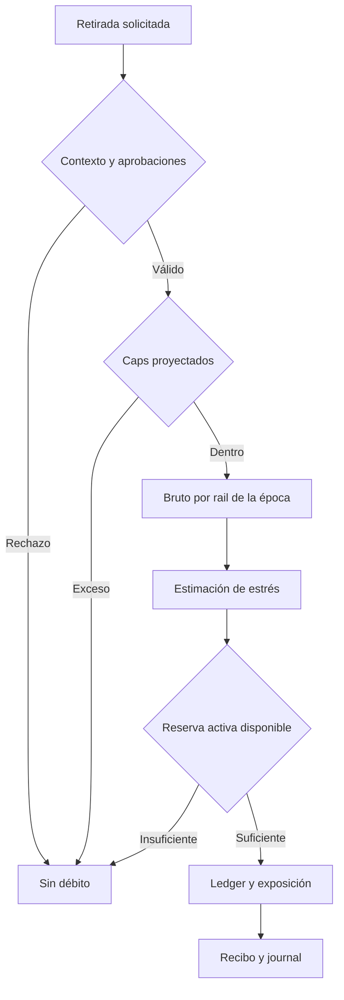
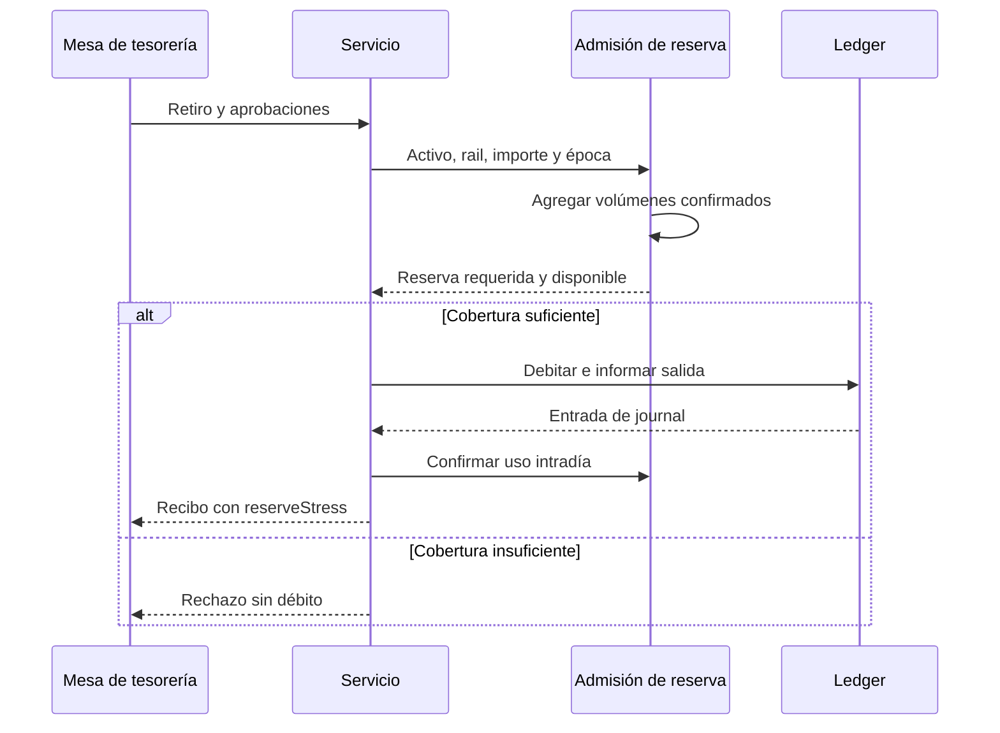

# Admisión de reserva intradía

## Alcance

Antes de confirmar un retiro externo, BastilleDTL contrasta la salida
proyectada del activo con la liquidez disponible en las cuentas de reserva
activas de la institución. La evaluación utiliza los volúmenes aceptados en
la época corriente, agrupados por rail, y las tasas de estrés configuradas.
Una transferencia interna no consume este presupuesto de salida, aunque puede
modificar el saldo de una cuenta de reserva antes de la siguiente evaluación.

Este control de ejecución es distinto del plan de netting para una ventana
completa. El plan aporta posiciones, concentración, buffer y escenarios; la
admisión intradía decide si una retirada concreta puede avanzar hasta el
ledger. Ambos resultados deben conciliarse al cerrar la época.



## Configuración

`EnginePolicy` incluye `railStressBps`. Cada rail permitido necesita una tasa
entre `0` y `10.000` bps; el control se aplica a toda retirada.
La reserva elegible procede de cuentas `reserve` habilitadas, pertenecientes
a la institución y compatibles con el activo. Solo su saldo `available` se
considera liquidez inmediata; los fondos `reserved` no se reutilizan.

Ejemplo de política parcial:

```json
{
    "allowedWithdrawalRails": ["swift", "sepa", "wire", "ach"],
    "railStressBps": {
        "swift": 3000,
        "sepa": 100,
        "wire": 1500,
        "ach": 500
    }
}
```

Los valores monetarios son enteros de la unidad mínima del activo. El
bootstrap de referencia usa USDC de seis decimales y saldos de ejemplo
reducidos; en una integración se parametrizan según la tesorería aprobada.

## Ejemplo operativo

Con reserva disponible `100.000` unidades base y un retiro `swift` de
`300.000`, el recibo informa `requiredReserve=90.000`. Otro retiro `swift` de
`50.000` en la misma época proyecta `105.000` y se rechaza sin modificar
balances ni exposición. Al avanzar la época, el bruto intradía empieza una
nueva ventana; el journal anterior permanece para reconciliación.



## Conciliación y recuperación

El operador compara por institución, activo y época los retiros confirmados,
el bruto por rail, la reserva disponible y la estimación guardada en cada
recibo. Un rechazo por reserva no debe aparecer como entrada de retirada en
el journal. Si hay discrepancias, se detienen nuevas salidas y se preservan
snapshot, receipts y configuración; el procedimiento de contención está en
[Operaciones](operaciones.md).
